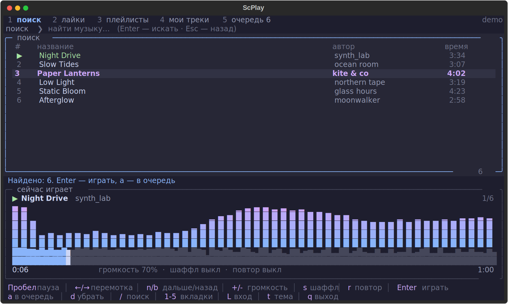

# scplay

SoundCloud прямо в терминале: поиск, лайки, плейлисты, очередь, **визуализатор спектра** и **волна трека** с перемоткой кликом. Всё управляется с клавиатуры, горячие клавиши всегда видны внизу экрана.



> Неофициальный клиент. Проект не связан с SoundCloud. Он использует [yt-dlp](https://github.com/yt-dlp/yt-dlp) для получения потока и [mpv](https://mpv.io) для воспроизведения. Пользуйся им в рамках [условий использования SoundCloud](https://soundcloud.com/terms-of-use).

## Возможности

- Поиск по SoundCloud, воспроизведение по ссылке на трек, плейлист или профиль
- Вход в аккаунт: **лайки**, **плейлисты** и **мои треки** (через cookie браузера, пароль не нужен и нигде не хранится)
- Очередь, шаффл, повтор (выкл / все / один), громкость
- Быстрая загрузка: ссылка на трек запрашивается за 2 запроса, а следующий трек из очереди подготавливается заранее, пока играет текущий, поэтому переходы без пауз
- Визуализатор спектра в реальном времени и волна всего трека с проигранной частью
- Перемотка клавишами или кликом мыши по волне
- Четыре темы: `mocha`, `nord`, `gruvbox`, `rosepine` (клавиша `t`)
- Локальные файлы тоже играются: `scplay song.mp3`
- Встроенная диагностика: `scplay --diagnose`

## Требования

- Python 3.10+
- [mpv](https://mpv.io) и [ffmpeg](https://ffmpeg.org) в `PATH`
- Терминал с поддержкой Unicode и цвета (лучше от 100×28 символов)

## Установка

Рекомендуемый способ — [pipx](https://pipx.pypa.io): он ставит программу в изолированное окружение и создаёт команду `scplay`.

**1. Поставь mpv, ffmpeg и pipx**

| Система          | Команда                                                                                                      |
| ---------------- | ------------------------------------------------------------------------------------------------------------ |
| macOS (Homebrew) | `brew install mpv ffmpeg pipx`                                                                               |
| Debian / Ubuntu  | `sudo apt install mpv ffmpeg pipx`                                                                           |
| Arch             | `sudo pacman -S mpv ffmpeg python-pipx`                                                                      |
| Fedora           | `sudo dnf install mpv ffmpeg pipx` (ffmpeg может потребовать RPM Fusion)                                     |
| Windows (winget) | `winget install --id shinchiro.mpv -e` и `winget install Gyan.FFmpeg`, затем `py -m pip install --user pipx` |

После установки pipx выполни `pipx ensurepath` и открой новое окно терминала.

**2. Поставь scplay**

Прямо из GitHub:

```
pipx install git+https://github.com/YOUR_USERNAME/scplay.git
```

Или из клонированной папки (удобно для разработки: изменения в `scplay.py` применяются сразу):

```
git clone https://github.com/YOUR_USERNAME/scplay.git
cd scplay
pipx install --editable .
```

**3. Запусти**

```
scplay                  # открыть интерфейс
scplay lofi hip hop     # сразу поиск
scplay https://soundcloud.com/...   # играть ссылку
scplay song.mp3         # играть локальный файл
```

Обновление: `pipx upgrade scplay` (или `git pull` в папке, если ставил с `--editable`). Удаление: `pipx uninstall scplay`.

## Управление

| Клавиша       | Действие                                                                                  |
| ------------- | ----------------------------------------------------------------------------------------- |
| `/`           | поиск (Enter — искать, Esc — назад к списку)                                              |
| `Enter`       | играть выбранное (для плейлиста — открыть и играть)                                       |
| `Пробел`      | пауза                                                                                     |
| `←` / `→`     | перемотка на 5 секунд                                                                     |
| клик по волне | перемотка в нужное место                                                                  |
| `n` / `b`     | следующий / предыдущий трек (`b` после 3 секунд возвращает в начало)                      |
| `+` / `-`     | громкость                                                                                 |
| `s`           | шаффл                                                                                     |
| `r`           | повтор: выкл → все → один                                                                 |
| `a`           | добавить в очередь                                                                        |
| `d`           | убрать из очереди (на вкладке «Очередь»)                                                  |
| `1`…`5`       | вкладки: поиск, лайки, плейлисты, мои треки, очередь (повторное нажатие обновляет список) |
| `L`           | вход в аккаунт / выход                                                                    |
| `t`           | сменить тему                                                                              |
| `q`           | выход                                                                                     |

В строке поиска можно вставить ссылку на трек, плейлист или профиль SoundCloud.

## Вход в аккаунт

У SoundCloud нет входа по паролю для сторонних программ, поэтому используется сессия браузера:

1. Войди в свой аккаунт на soundcloud.com в браузере.
2. В `scplay` нажми `L` и введи название браузера: `firefox`, `chrome`, `edge`, `brave`, `safari` и т. п.
3. Программа найдёт сессию, определит твой профиль и запомнит выбор. Теперь доступны вкладки 2, 3 и 4.

Если браузер не читается, экспортируй cookie в файл (например, расширением «Get cookies.txt LOCALLY») и введи `file путь/до/cookies.txt`. Выйти можно командой `logout` в том же окне ввода.

Сами cookie и токены в конфиг не копируются, сохраняется только имя браузера или путь к файлу. Файл `cookies.txt` даёт доступ к аккаунту: не коммить его в git и никому не отправляй.

## Где хранятся настройки

`~/.config/scplay/config.json` (тема, громкость, браузер для входа) и `~/.config/scplay/mpv.log` (вывод mpv для диагностики). На Windows это `C:\Users\<имя>\.config\scplay\`.

## Поддерживаемые платформы

| Платформа             | Статус                                                                                                                                                                                                     |
| --------------------- | ---------------------------------------------------------------------------------------------------------------------------------------------------------------------------------------------------------- |
| macOS (Apple Silicon) | ✅ основная платформа, работает                                                                                                                                                                            |
| Linux                 | 🟡 ожидаемо работает: интерфейс, управление и воспроизведение проверены на Ubuntu. Для входа из Chrome/Chromium может понадобиться `pip install secretstorage`; проще использовать Firefox                 |
| Windows               | ⚠️ экспериментально, не проверялось. Нужен современный терминал (Windows Terminal). Вход через cookie Chrome/Edge может не работать из-за их шифрования, в этом случае используй Firefox или `cookies.txt` |

Если нашёл проблему на своей системе, открой issue и приложи вывод `scplay --diagnose`.

## Частые проблемы

**`scplay --diagnose`** проверяет mpv и ffmpeg, окружение и по шагам прогоняет запуск, подключение и воспроизведение (звук при этом выключен). Первым делом запусти его.

**mpv падает с `bus error` / SIGBUS на macOS.** Это сбой самого mpv, а не программы. Проверь, что `mpv --version` работает в обычном терминале. Одна из известных причин — переменная окружения `DYLD_LIBRARY_PATH` в `~/.zshrc`; `scplay` очищает `DYLD_*` для своих дочерних процессов, но лучше убрать её совсем. Если падает даже `env -i HOME="$HOME" PATH=/opt/homebrew/bin:/usr/bin:/bin mpv --version`, помогает `brew reinstall mpv`.

**Трек висит на «загрузка…».** Посмотри красное сообщение внизу и файл `~/.config/scplay/mpv.log`. Если ошибка от yt-dlp, обнови его: `pipx upgrade scplay` или `pipx inject scplay yt-dlp --force`. Он часто обновляется под изменения SoundCloud.

**В лайках пусто или нет автора и длительности.** Нажми `2` ещё раз, чтобы обновить список. Если не помогло, перелогинься через `L`.

## Как это устроено

- `yt-dlp` ищет треки и получает прямую ссылку на аудио (с твоей авторизацией, если ты вошёл)
- `mpv` играет звук и управляется через JSON IPC ([python-mpv-jsonipc](https://github.com/iwalton3/python-mpv-jsonipc))
- ссылка на поток запрашивается напрямую (один формат вместо всех), а за несколько минут до конца трека следующий уже лежит в плейлисте mpv: он открывает его заранее и переходит без пауз; звук следующего трека декодируется заранее, поэтому визуализатор и волна готовы сразу
- `ffmpeg` параллельно декодирует тот же поток в моно-PCM, а `numpy` считает по нему спектр (FFT) и волну для любой позиции воспроизведения
- интерфейс написан на [Textual](https://textual.textualize.io)

## Лицензия

[MIT](LICENSE)
