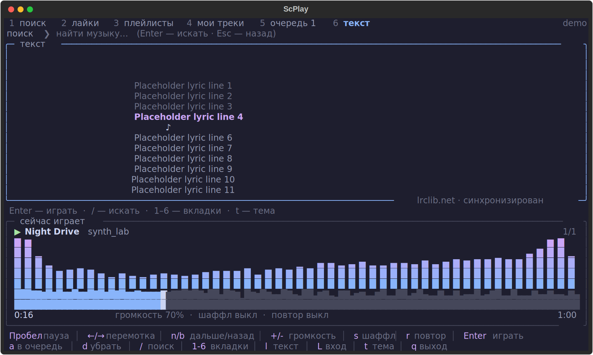

# scplay

SoundCloud прямо в терминале: поиск, лайки, плейлисты, очередь, **визуализатор спектра** и **волна трека** с перемоткой кликом. Всё управляется с клавиатуры, горячие клавиши всегда видны внизу экрана.


Вкладка «Текст» (на скриншоте строки-заглушки):



> Неофициальный клиент. Проект не связан с SoundCloud. Он использует [yt-dlp](https://github.com/yt-dlp/yt-dlp) для получения потока и [mpv](https://mpv.io) для воспроизведения. Пользуйся им в рамках [условий использования SoundCloud](https://soundcloud.com/terms-of-use).

## Возможности

- Поиск по SoundCloud, воспроизведение по ссылке на трек, плейлист или профиль
- Вход в аккаунт: **лайки**, **плейлисты** и **мои треки** (через cookie браузера, пароль не нужен и нигде не хранится)
- Очередь, шаффл, повтор (выкл / все / один), громкость
- Быстрая загрузка: ссылка на трек запрашивается за 2 запроса, а следующий трек из очереди подготавливается заранее, пока играет текущий, поэтому переходы без пауз
- Визуализатор спектра в реальном времени и волна всего трека с проигранной частью
- Перемотка клавишами или кликом мыши по волне
- **Тексты песен** с подсветкой текущей строки (вкладка `6` или клавиша `l`), клик по строке перематывает трек; текущая строка видна и на других вкладках
- **Управление извне TUI**: команды запущенному плееру (`scplay --send next`, `scplay --status`), медиа-клавиши и «сейчас играет» в системе
- Четыре темы: `mocha`, `nord`, `gruvbox`, `rosepine` (клавиша `t`)
- Локальные файлы тоже играются: `scplay song.mp3`
- Встроенная диагностика: `scplay --diagnose`, отладочный лог `~/.config/scplay/debug.log`

## Требования

- Python 3.10+
- [mpv](https://mpv.io) и [ffmpeg](https://ffmpeg.org) в `PATH`
- Терминал с поддержкой Unicode и цвета (лучше от 100×28 символов)

## Установка

Рекомендуемый способ — [pipx](https://pipx.pypa.io): он ставит программу в изолированное окружение и создаёт команду `scplay`.

**1. Поставь mpv, ffmpeg и pipx**

macOS и Linux:

| Система          | Команда                                                                  |
| ---------------- | ------------------------------------------------------------------------ |
| macOS (Homebrew) | `brew install mpv ffmpeg pipx`                                           |
| Debian / Ubuntu  | `sudo apt install mpv ffmpeg pipx`                                       |
| Arch             | `sudo pacman -S mpv ffmpeg python-pipx`                                  |
| Fedora           | `sudo dnf install mpv ffmpeg pipx` (ffmpeg может потребовать RPM Fusion) |

После установки pipx выполни `pipx ensurepath` и открой новое окно терминала.

Windows — через [Scoop](https://scoop.sh), всё делается в PowerShell:

```powershell
# 1. Сам Scoop (если ещё не стоит)
Set-ExecutionPolicy -ExecutionPolicy RemoteSigned -Scope CurrentUser
irm get.scoop.sh | iex

# 2. mpv лежит в bucket «extras»
scoop bucket add extras

# 3. Всё нужное одной командой (git нужен для установки из GitHub)
scoop install git python pipx mpv ffmpeg

# 4. Добавить pipx в PATH, затем открыть новое окно терминала
pipx ensurepath
```

Если `pipx` из Scoop по какой-то причине недоступен: `python -m pip install --user pipx`, затем `python -m pipx ensurepath`.

**2. Поставь scplay**

Прямо из GitHub:

```
pipx install git+https://github.com/kreepslayer/scplay.git
```

Или из клонированной папки (удобно для разработки: изменения в `scplay.py` применяются сразу):

```
git clone https://github.com/kreepslayer/scplay.git
cd scplay
pipx install --editable .
```

**3. Запусти**

```
scplay                  # открыть интерфейс
scplay lofi hip hop     # сразу поиск
scplay https://soundcloud.com/...   # играть ссылку
scplay song.mp3         # играть локальный файл
```

Обновление: `pipx upgrade scplay` (или `git pull` в папке, если ставил с `--editable`). Удаление: `pipx uninstall scplay`.

> Если ставил из клонированной папки через `--editable` и в новой версии появился ещё один файл (`scplay_media.py`), после `git pull` нужна переустановка: `pipx install --force --editable .`. Editable-установка запоминает список модулей на момент установки, и без этого появится `ModuleNotFoundError: No module named 'scplay_media'`.

## Управление извне TUI

Пока `scplay` играет, им можно управлять из другого окна терминала, скрипта,
Stream Deck или горячей клавиши — интерфейс для этого открывать не нужно.

```
scplay --status                 # что играет: трек, позиция, громкость, очередь
scplay --send next              # следующий трек
scplay --send toggle            # пауза / продолжить
scplay --send volume-rel -5     # тише на 5%
scplay --send volume 60         # ровно 60%
scplay --send seek 120          # перейти к 2:00
scplay --send seek-rel -10      # на 10 секунд назад
scplay --send repeat            # повтор: выкл → все → один
scplay --send shuffle           # шаффл
scplay --send queue             # очередь в JSON
scplay --send quit              # выйти из scplay
```

`scplay --send help` печатает список всех команд. Ответ — JSON, так что удобно
цеплять к скриптам: `scplay --status` читается глазами, а `scplay --send queue`
отдаёт массив объектов.

Технически это локальный сокет в системном временном каталоге, доступный только
текущему пользователю (`scplay --send` из-под другого пользователя не пройдёт).
Второй экземпляр `scplay` на том же канале не поднимется — вместо этого он
сообщит, что плеер уже запущен.

### Системная медиа-сессия

- **macOS.** Название, исполнитель и позиция публикуются в Пункт управления
  (Now Playing), а медиа-клавиши `⏯` `⏭` `⏮` присылают команды в плеер. Работает
  без сторонних пакетов, через системный `MediaPlayer.framework`.
- **Linux.** Интерфейс MPRIS2: трек виден в GNOME/KDE, `playerctl play-pause` и
  мультимедийные клавиши управляют плеером. Нужен пакет `dbus-next`:
  `pipx inject scplay dbus-next` (на Python 3.13+ он пока не работает — см.
  «Частые проблемы»).
- **Windows.** Системная медиа-сессия пока не подключена, но канал `--send`
  работает: команды можно повесить на горячие клавиши любым лаунчером.
- **Отключить** всё это: `SCPLAY_MEDIA=0 scplay` или `"media": false` в
  `config.json`.

## Управление

| Клавиша           | Действие                                                                                                |
| ----------------- | ------------------------------------------------------------------------------------------------------- |
| `/`               | поиск (Enter — искать, Esc — назад к списку)                                                            |
| `Enter`           | играть выбранное (для плейлиста — открыть и играть)                                                     |
| `Пробел`          | пауза                                                                                                   |
| `←` / `→`         | перемотка на 5 секунд                                                                                   |
| клик по волне     | перемотка в нужное место                                                                                |
| `n` / `b`         | следующий / предыдущий трек (`b` после 3 секунд возвращает в начало)                                    |
| `+` / `-`         | громкость                                                                                               |
| `s`               | шаффл                                                                                                   |
| `r`               | повтор: выкл → все → один                                                                               |
| `a`               | добавить в очередь                                                                                      |
| `d`               | убрать из очереди (на вкладке «Очередь»)                                                                |
| `1`…`6`           | вкладки: поиск, лайки, плейлисты, мои треки, очередь, текст (повторное нажатие на 2–4 обновляет список) |
| `l`               | текст песни: открыть / вернуться к предыдущей вкладке                                                   |
| `[` / `]`         | подогнать синхронизацию текста: позже / раньше на 0,5 с                                                 |
| `↑` / `↓`, колесо | прокрутка текста без таймкодов                                                                          |
| `L`               | вход в аккаунт / выход                                                                                  |
| `t`               | сменить тему                                                                                            |
| `q`               | выход                                                                                                   |

В строке поиска можно вставить ссылку на трек, плейлист или профиль SoundCloud.

## Тексты песен

Открой вкладку `6` (или нажми `l`) во время игры. Если у трека есть текст с таймкодами, текущая строка подсвечивается и держится по центру, а клик по любой строке перематывает трек на неё. Если таймкодов нет, текст показывается целиком, его можно листать клавишами `↑` / `↓` или колесом мыши. Текущая строка также видна под списком на остальных вкладках.

- **Откуда берутся тексты.** У SoundCloud своих текстов нет, поэтому используется открытая база [LRCLIB](https://lrclib.net). Программа ищет по названию, исполнителю и длительности трека. Для SoundCloud это не всегда точно: названия вроде «Артист - Трек (Remix)» очищаются от лишнего, но для ремиксов, бутлегов и малоизвестных треков текст часто не находится или отличается по времени. Подогнать его можно клавишами `[` и `]`.
- **Что отправляется наружу.** Только название, имя автора и длительность трека на `lrclib.net`. Сам звук, твои cookie и аккаунт никуда не передаются.
- **Кэш.** Найденные тексты хранятся на твоём компьютере в `~/.config/scplay/lyrics/`, чтобы не запрашивать их повторно. Отсутствие текста не перепроверяется сутки.
- **Локальные файлы.** Для `scplay song.mp3` текст берётся из файла `song.lrc` рядом с треком (если он есть).
- **Отключить.** Добавь в `~/.config/scplay/config.json` строку `"lyrics": false`, и программа не будет обращаться к LRCLIB.

Тексты песен принадлежат правообладателям. Программа не содержит и не распространяет их, а только показывает тебе то, что отдаёт сторонний сервис.

## Вход в аккаунт

У SoundCloud нет входа по паролю для сторонних программ, поэтому используется сессия браузера:

1. Войди в свой аккаунт на soundcloud.com в браузере.
2. В `scplay` нажми `L` и введи название браузера: `firefox`, `chrome`, `edge`, `brave`, `safari` и т. п.
3. Программа найдёт сессию, определит твой профиль и запомнит выбор. Теперь доступны вкладки 2, 3 и 4.

Если браузер не читается, экспортируй cookie в файл (например, расширением «Get cookies.txt LOCALLY») и введи `file путь/до/cookies.txt`. Выйти можно командой `logout` в том же окне ввода.

Сами cookie и токены в конфиг не копируются, сохраняется только имя браузера или путь к файлу. Файл `cookies.txt` даёт доступ к аккаунту: не коммить его в git и никому не отправляй.

## Где хранятся настройки

`~/.config/scplay/config.json` (тема, громкость, браузер для входа) `~/.config/scplay/mpv.log` (вывод mpv для диагностики), `~/.config/scplay/debug.log` (отладочный лог: ошибки загрузки, resolve, медиа-сессии), `~/.config/scplay/crash.log` (падения: строки «сессия запущена» — это нормальные отметки о запуске) и `~/.config/scplay/lyrics/` (кэш текстов). На Windows это `C:\Users\<имя>\.config\scplay\`. Файл конфига и каталог кэша доступны только владельцу (`0600` и `0700`).

## Поддерживаемые платформы

| Платформа             | Статус                                                                                                                                                                                                                        |
| --------------------- | ----------------------------------------------------------------------------------------------------------------------------------------------------------------------------------------------------------------------------- |
| macOS (Apple Silicon) | ✅ основная платформа, работает                                                                                                                                                                                               |
| Linux                 | 🟡 ожидаемо работает: интерфейс, управление и воспроизведение проверены на Ubuntu. Для входа из Chrome/Chromium может понадобиться `pip install secretstorage`; проще использовать Firefox                                    |
| Windows               | ✅ работает (проверено; установка через Scoop). Лучше использовать Windows Terminal. Если вход через cookie Chrome/Edge не сработал (у этих браузеров свои ограничения на чтение cookie), используй Firefox или `cookies.txt` |

Если нашёл проблему на своей системе, открой issue и приложи вывод `scplay --diagnose`.

## Частые проблемы

**`scplay --diagnose`** проверяет mpv и ffmpeg, окружение и по шагам прогоняет запуск, подключение и воспроизведение (звук при этом выключен). Первым делом запусти его.

**mpv падает с `bus error` / SIGBUS на macOS.** Это сбой самого mpv, а не программы. Проверь, что `mpv --version` работает в обычном терминале. Одна из известных причин — переменная окружения `DYLD_LIBRARY_PATH` в `~/.zshrc`; `scplay` очищает `DYLD_*` для своих дочерних процессов, но лучше убрать её совсем. Если падает даже `env -i HOME="$HOME" PATH=/opt/homebrew/bin:/usr/bin:/bin mpv --version`, помогает `brew reinstall mpv`.

**`mpv` / `ffmpeg` не найден после `scoop install` (Windows).** Открой новое окно PowerShell: PATH обновляется только в новых окнах. Проверь `mpv --version` и `ffmpeg -version`. Если mpv не находится, убедись, что добавлен bucket `extras` (`scoop bucket add extras`).

**Трек висит на «загрузка…».** Посмотри красное сообщение внизу и файл `~/.config/scplay/mpv.log`. Если ошибка от yt-dlp, обнови его: `pipx upgrade scplay` или `pipx inject scplay yt-dlp --force`. Он часто обновляется под изменения SoundCloud.

**Текст не находится.** Проверь, что `scplay --diagnose` показывает «✓ сервис доступен» в блоке «тексты песен». Для ремиксов и малоизвестных треков текста в базе может просто не быть. Если текст есть, но не совпадает по времени, подгони его клавишами `[` и `]`.

**`scplay --send` пишет «не удалось связаться».** Значит, играющий экземпляр не запущен или его канал занят: команды принимает только один `scplay`. Проверь `scplay --status`. Если плеер точно работает, посмотри `~/.config/scplay/debug.log` — там будет причина (например, каталог для сокета недоступен).

**Медиа-клавиши не работают, а в Пункте управления macOS пусто.** Система считает «сейчас играющим» то приложение, которое первым заявило медиа-сессию; из терминала это может занять несколько секунд или уступить браузеру. Метаданные scplay отправляет всегда — их видно, если закрыть другие плееры. Проверить, что дело не в медиа-слое: `SCPLAY_MEDIA=0 scplay`, а управлять извне через `scplay --send` это не мешает.

**На Linux не появляется MPRIS (`playerctl` не видит плеер).** Нужен пакет `dbus-next` (`pipx inject scplay dbus-next`) и запущенная сессия D-Bus. На Python 3.13+ `dbus-next` пока падает на импорте (`typing.no_type_check_decorator`) — тогда используй `--send` или запусти scplay под Python ≤3.12.

**Трек висит на «загрузка…».** Посмотри красное сообщение внизу и файл `~/.config/scplay/mpv.log`. Если ошибка от yt-dlp, обнови его: `pipx upgrade scplay` или `pipx inject scplay yt-dlp --force`. Он часто обновляется под изменения SoundCloud. Причину отказа resolve теперь всегда видно в `~/.config/scplay/debug.log`.

**В лайках пусто или нет автора и длительности.** Нажми `2` ещё раз, чтобы обновить список. Если не помогло, перелогинься через `L`.

**После сбоя терминал показывает мусор.** Так бывает, если процесс упал в полноэкранном режиме. Верни терминал командой `reset` (или `stty sane`), затем посмотри `~/.config/scplay/crash.log`: туда пишутся и ошибки Python, и нативные падения со стеком всех потоков. Если файл заканчивается только строкой «сессия запущена», значит падения не было, а мусор — следствие криво завершившегося экземпляра; в этом случае помогут `pkill -f 'bin/scplay'` и повторный запуск.

## Как это устроено

- `yt-dlp` ищет треки и получает прямую ссылку на аудио (с твоей авторизацией, если ты вошёл)
- `mpv` играет звук и управляется через JSON IPC ([python-mpv-jsonipc](https://github.com/iwalton3/python-mpv-jsonipc))
- ссылка на поток запрашивается напрямую (один формат вместо всех), а за несколько минут до конца трека следующий уже лежит в плейлисте mpv: он открывает его заранее и переходит без пауз; звук следующего трека декодируется заранее, поэтому визуализатор и волна готовы сразу
- если быстрый путь resolve перестаёт работать (например, после обновления yt-dlp), он отключается сам после двух отказов, и загрузка идёт обычным способом — без двойной работы на каждом треке
- `ffmpeg` параллельно декодирует тот же поток в моно-PCM, а `numpy` считает по нему спектр (FFT) и волну для любой позиции воспроизведения; звук для спектра хранится в кольцевом буфере на 10 минут, а огибающая волны — по всему треку, поэтому длинные миксы не съедают память
- `scplay_media.py` даёт управление извне: локальный сокет для `--send`/`--status`, «сейчас играет» в macOS (MediaPlayer.framework) и MPRIS на Linux
- тексты ищутся в [LRCLIB](https://lrclib.net) и разбираются из формата LRC; текущая строка определяется по позиции воспроизведения
- интерфейс написан на [Textual](https://textual.textualize.io)

## Тесты

```
./venv/bin/python tests/test_units.py    # разбор LRC, имена, очередь, конфиг, канал, watchdog
./venv/bin/python tests/smoke_tui.py     # приложение, mpv, анализатор, канал управления
./venv/bin/python tests/smoke_cli.py     # scplay --status / --send отдельными процессами
```

Юнит-тесты не требуют сети и mpv. Smoke-тесты поднимают настоящий mpv на локальном
файле, сгенерированном ffmpeg, и работают в своём временном каталоге — рабочий
`~/.config/scplay` они не трогают.

Запускать можно и системным `python3 tests/test_units.py`: тесты сами проверят
зависимости и перезапустятся через `venv/bin/python`, если в текущем интерпретаторе
нет numpy/textual/yt-dlp. Если `venv` нет (например, scplay поставлен через pipx),
запускай тесты тем же интерпретатором, в котором стоит scplay.

## Лицензия

[MIT](LICENSE)
